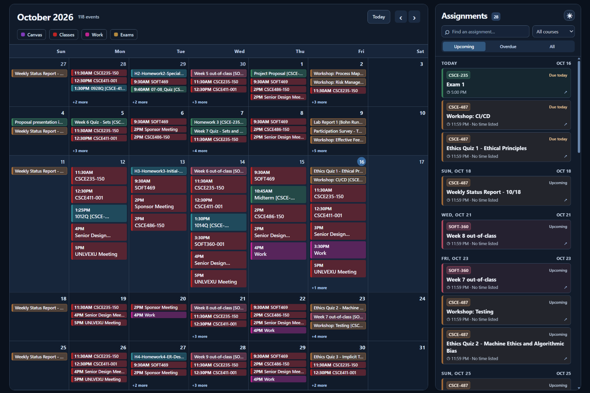
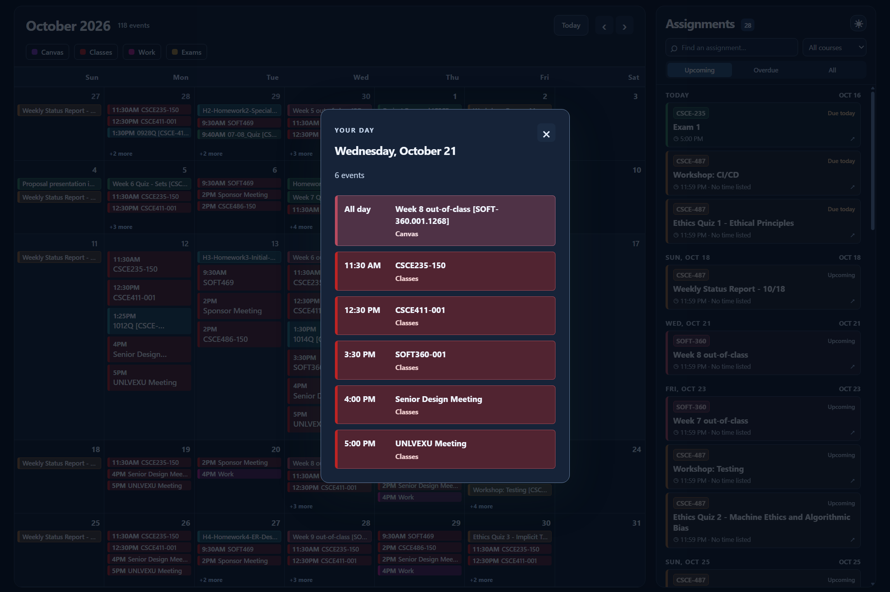
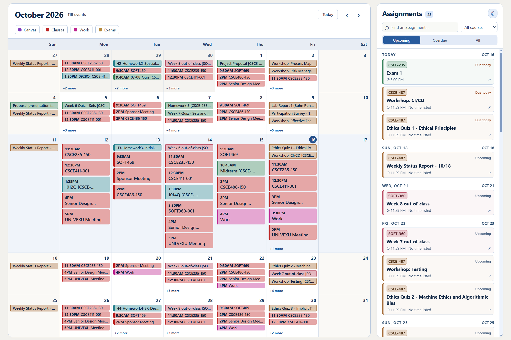
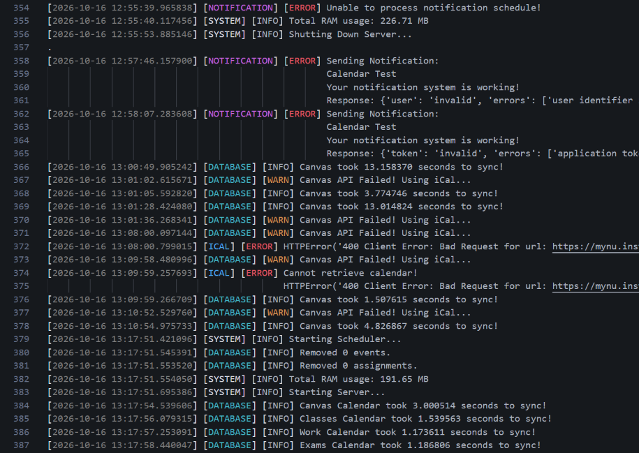

# College Calendar

College Calendar brings your calendars and Canvas assignments together in one dashboard. View upcoming events, track assignment deadlines, and receive scheduled daily and weekly reminders through Pushover.





## Features

- Dashboard
  - Coloring is deterministic depending on what classification it falls under:
    - Course code for assignments
    - Calendar name for events
  - Coloring can be overridden in `calendars.json`
- Canvas Assignments
  - Tries to use the Canvas API through `canvasapi`
  - Uses iCal syncing as a backup
  - Stores assignments from 45 days ago up to 120 days in the future
  - Submitted assignments are filtered out of the dashboard view
- Calendar Events
  - Syncs using iCal links
  - Stores events from 45 days ago up to 120 days in the future
- Notifications (using Pushover)
  - Schedule is set using `notification_schedule.json`
    - Control what days and times both weekly and daily notifications are sent
  - Daily notification will send a list of all assignments due that day that are not yet turned in
    - If no assignments are due, or if all of the assignments are complete, a weekly notification will be sent instead
  - Weekly notifications will send a count and a list of all assignments due in the next 7 days, including today
- Logging
  
  - Color coding using ANSI escape characters
    - Only used if log file is .ans or .ansi type, or if printing to the terminal
    - Escape characters are removed for all other file types
  - Log file defined in `.env`, if no file is provided, logs will print to the terminal
  - Logs are queued within each process before being written


## Setup & Configuration

Install Python 3.14, then clone or download this repository. Open a terminal in the `College-Calendar` project root, where `run.py` and `requirements.txt` are located. Run the following setup commands from that folder.

### Virtual Environment

A virtual environment keeps this project's packages separate from other Python projects.

#### Creating a Virtual Environment

Use the following command to create a virtual environment:

```bash
python -m venv venv
```

This project was developed and tested using Python 3.14. Check the interpreter selected by `python` with `python --version`. On Windows, if the Python launcher is installed, you can select Python 3.14 explicitly:

```bash
py -3.14 -m venv venv
```

#### Activating a Virtual Environment

Use the command for your operating system and terminal. These examples use `venv` as the environment name; replace it if you chose a different name.

##### Command Prompt (Windows)

```cmd
venv\Scripts\activate.bat
```

##### PowerShell (Windows)

```powershell
.\venv\Scripts\Activate.ps1
```

##### PowerShell (Linux/macOS)

```powershell
./venv/bin/Activate.ps1
```

##### Git Bash (Windows)

```bash
source venv/Scripts/activate
```

##### Bash (Linux/macOS)

```bash
source venv/bin/activate
```


### Requirements

With the virtual environment activated, install the requirements:

```bash
python -m pip install -r requirements.txt
```


### User-Config

Configure the app using these files in the project root. The sections below explain which features need each file:
- `.env` - Contains environment variables
- `calendars.json` - Contains iCal links and other related information
- `notification_schedule.json` - Contains schedule information for notifications

### .env

Only `TIME_ZONE` is required to start the app. The other variables enable Canvas API syncing, notifications, and file logging. Start with this `.env` example and replace the placeholders with your own values. Omit optional variables for features you do not use.

```dotenv
TIME_ZONE=America/Chicago
CANVAS_URL=https://your-school.instructure.com
CANVAS_API_KEY=your_canvas_access_token
PUSHOVER_APP_KEY=your_pushover_app_key
PUSHOVER_USER_KEY=your_pushover_user_key
LOG_PATH=calendar.log
```


- `TIME_ZONE` - Used to determine local time zone. Central time is "America/Chicago"
- `CANVAS_URL` - The URL to your organization's Canvas instance. This is used in the notifications if there are multiple assignments. It is also used to fetch assignments using the Canvas API. If it is missing, the app will use iCal to sync assignments and will not give a link in any notifications. iCal cannot determine if an assignment is turned in.
- `CANVAS_API_KEY` - Also called a personal access token. This can be generated at Canvas > Account > Settings > Approved Integrations > "+ New Access Token". You may have to ask your IT department to generate one for you. Token availability and expiration depend on your account role and institution settings. Check the expiration when creating your token and replace it when needed. If this is incorrect or missing, the app will attempt to use iCal to sync assignments.
- `PUSHOVER_APP_KEY` - Create an application at [Pushover](https://pushover.net/apps/build) to get its API token. Creating an app key is free; message limits apply. If this is incorrect or missing, you cannot receive notifications.
- `PUSHOVER_USER_KEY` - This is generated when you create an account and is viewable at [Pushover](https://pushover.net/). Pushover clients have a 30-day free trial, followed by a one-time license purchase for each platform you use. See [Pushover pricing](https://pushover.net/pricing). If this is incorrect or missing, you cannot receive notifications.
- `LOG_PATH` - Where you want the logs to be printed. If you want color added, use a .ans or .ansi file. If this is missing, logs will be printed to the Python terminal, with color.

### calendars.json

If this file is missing or incomplete, events from the iCal links will not be synced to the dashboard. Additionally, if the Canvas API cannot complete the assignment sync and this file is missing or incomplete, the assignments will not be synced.

#### Layout

```json
{
    "calendars": [
        {
            "name": "<calendar-name>",
            "url": "<iCal-Link>",
            "color": "<desired-hex-color-code>"
        }
    ],
    "assignment_colors": {
        "<course_code>": "<desired-hex-color-code>"
    }
}
```

The calendar name is used when displaying calendars. Name the calendar containing your Canvas assignment feed exactly `"Canvas"` so the app can find it for the iCal fallback.

Colors are optional and use the `#RRGGBB` format. If a color is missing, the calendar name or course code gets hashed to choose a consistent color. `assignment_colors` overrides colors by course code, applying to all assignments in that course. Replace the placeholders above with your own values and add calendar objects or course entries as needed.

#### Example

```json
{
    "calendars": [
        {
            "name": "Canvas",
            "url": "https://mynu.instructure.com/<Redacted For Privacy>",
            "color": "#803aba"
        }
    ],
    "assignment_colors": {
        "CSCE-411.001.1268": "#a56c38"
    }
}
```

### notification_schedule.json

If this file is missing or incomplete, you cannot receive notifications.

#### Layout

```json
{
    "daily": {
        "days": [
            "<day-prefix>"
        ],
        "times": [
            "<24-hour-time>"
        ]
    },
    "weekly": {
        "days": [
            "<day-prefix>"
        ],
        "times": [
            "<24-hour-time>"
        ]
    }
}
```

Use lowercase day prefixes: `mon`, `tue`, `wed`, `thu`, `fri`, `sat`, and `sun`. Times use the `HH:MM` 24-hour format in the `TIME_ZONE` configured in `.env`, so `18:00` means 6:00 PM. Each listed time runs on every listed day for that notification type.

#### Example

```json
{
    "daily": {
        "days": [
            "mon",
            "tue",
            "wed",
            "thu",
            "fri",
            "sat",
            "sun"
        ],
        "times": [
            "12:00",
            "18:00",
            "21:00"
        ]
    },
    "weekly": {
        "days": [
            "mon",
            "tue",
            "wed",
            "thu",
            "fri",
            "sat",
            "sun"
        ],
        "times": [
            "09:00"
        ]
    }
}
```

## Running the App

With the virtual environment activated, run this command from the project root:

```bash
python run.py
```

This starts the API and scheduler, then opens the dashboard in your default browser when the server is ready. You can also open [http://localhost:8000/](http://localhost:8000/) manually.

Press **Ctrl+C** in the launcher terminal to stop the app. Afterward, run `deactivate` to exit the virtual environment. Deactivating the environment does not stop an app that is still running.

### Access from Another Device

#### On the Same Network

While the app is running, another device on the same local network can open `http://<app-ip>:8000/` in its browser. Replace `<app-ip>` with the local IP address of the computer running the app, such as `http://192.168.1.100:8000/`. Use the app computer's IP address, rather than the router's address or `localhost`.

On Windows, run `ipconfig` on the app computer and find the IPv4 address for its active Wi-Fi or Ethernet connection. If the page cannot be reached, check that the host firewall allows incoming connections to TCP port 8000 and that the network allows devices to communicate with each other.

#### Using Tailscale

To access the app from a different network, install [Tailscale](https://tailscale.com/download) on both the computer running the app and the device viewing it. Sign both devices into the same Tailscale network (tailnet) and leave Tailscale connected.

Find the app computer's Tailscale IP address in the Tailscale app or admin console. On the other device, open `http://<tailscale-ip>:8000/`, replacing `<tailscale-ip>` with that address. Keep the app running on the host computer, and ensure your tailnet's access rules and the host firewall allow connections to TCP port 8000.

This uses the app's existing server directly; Tailscale Serve and router port forwarding are not required. See [Tailscale's device connection guide](https://tailscale.com/docs/how-to/connect-to-devices) for more details.

### Running Individual Modules

To run a Python module directly from the project root, use its dotted module path without the `.py` extension:

```bash
python -m path.to.module
```

Some modules were run separately for manual testing. They are not all guaranteed to work on their own; use `python run.py` for normal startup.
